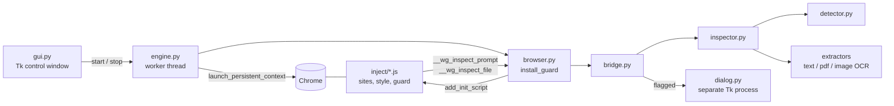
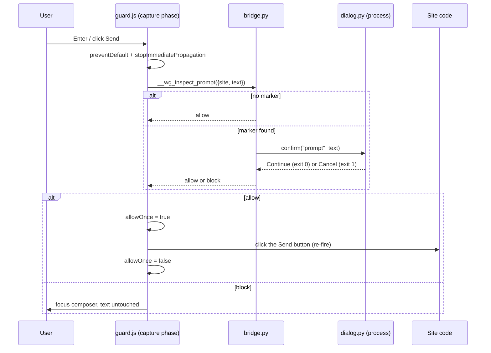
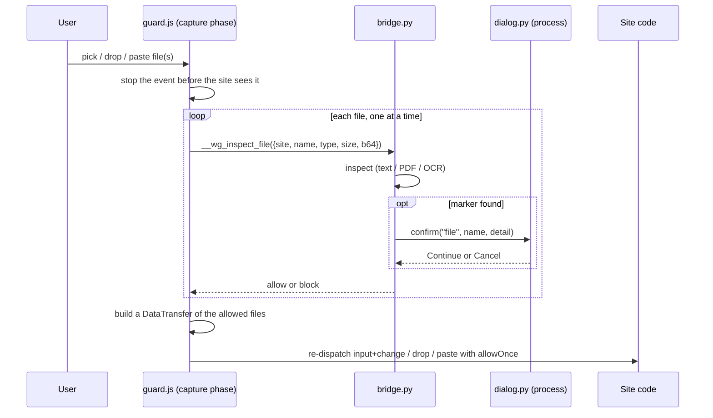

# Architecture Overview

## Why Playwright-driven Chrome, not an extension

The assignment requires a standalone desktop application and rules out browser extensions, plugins and add-ons. The app
is therefore a Python program that launches the user's installed Chrome with Playwright and a persistent profile.
Nothing is installed in the browser. The program injects one script into pages of the two supported sites and serves
two Python functions to it. Pages on any other host are never touched.

## Components

## Prompt flow

## File flow

## Interception and enforcement

- **Capture phase.** `guard.js` registers listeners on `window` with `capture: true`, so they run before the site's own
  handlers. For Enter, Send click, form submit, file-input `input`/`change`, `drop` and `paste` the listener calls
  `preventDefault()` and `stopImmediatePropagation()`: the site never sees the action, so nothing is transmitted.
- **Inspection.** The page script calls Playwright bindings (`__wg_inspect_prompt`, `__wg_inspect_file`). File bytes are
  read with `FileReader` and passed to Python as base64. The page waits for Python's answer.
- **`allowOnce` re-dispatch.** On *allow* the script sets `allowOnce = true`, re-fires the original action (it clicks the
  site's own Send button; for files it re-dispatches the event with the original `File` objects) and resets the flag in a
  `finally`. Listeners ignore events while the flag is set, so the re-fired action goes through exactly once.
- **Continue** passes the very same `File` objects and composer text; nothing is modified (tests compare SHA-256 of the
  uploaded bytes). **Cancel** drops the action: the composer text is left as is, a blocked file input is cleared so the
  same file can be selected again, and a normal retry runs the same checks again.
- **Multiple files.** Files are inspected sequentially, one dialog at a time. Cancel removes only that file; the rest
  proceed. A guard (`pendingPrompt`, a promise queue for files) prevents overlapping flows and double sends.
- **Scope.** The script does nothing unless `location.hostname` belongs to ChatGPT or Perplexity (a test host is enabled only
  when `WALLED_ENABLE_HARNESS=1`). Plain-text paste, Shift+Enter, empty prompts and unflagged files pass through unchanged.

## Policy: fail-closed and fail-open

| Situation | Outcome | Reason |
|---|---|---|
| Marker found, dialog cannot be shown or crashes | **Block** | Never let flagged content out without a decision |
| Inspection error, unreadable file, file > 30 MB | **Allow + log** | A broken inspector must not break the sites |
| Binding missing or throwing in the page | **Allow**, state reset | Same: no stuck UI |

Logs hold metadata only (site, kind, file name, decision); prompt and file content are never logged.

## Why the dialog is a separate process

`dialog.confirm()` runs `python -m walled_guard.dialog` with `subprocess.run` and maps the exit code (0 Continue, anything else
Cancel). A Tk window needs the main thread of its process, which the control window and the Playwright callbacks already
use, and a crash or hang of the dialog cannot take the app down. It is a real native window, always on top and centred,
keyboard focus on Cancel; Esc and the close button cancel and Enter is ignored. Tests bypass it with
`WALLED_DIALOG_AUTO=continue|cancel`.

## Response colour

`style.js` injects a `<style id="__wg_style">` with `color` and `-webkit-text-fill-color` (`!important`) for the assistant-message
selectors of the current site, at document start, and re-adds it with a `MutationObserver` if the page removes it. Because it
is CSS keyed on selectors, it applies to streaming and reloaded answers alike. Both sites use the same colour (`config.RESPONSE_COLOR`).

## Modules

| Module | Responsibility |
|---|---|
| `config.py` | Marker, limits, colour, paths, site table |
| `detector.py` | Exact and OCR-tolerant marker matching (pure functions) |
| `extractors/text.py` | BOM-aware decoding, text heuristics |
| `extractors/image.py` | Image normalisation and OCR (lazy singleton engine) |
| `extractors/pdf.py` | PDF text layer plus OCR of scanned / image pages |
| `inspector.py` | File-type detection and the single `inspect_prompt` / `inspect_file` entry points |
| `dialog.py` | Native confirmation dialog, fail-closed launcher |
| `bridge.py` | Page-facing handlers, decision flow |
| `inject/*.js`, `script_builder.py` | Page script: selectors, colour, interception |
| `browser.py` | Injects the script and exposes the bindings in a Playwright context |
| `engine.py` | Launches Chrome (Playwright, one worker thread), serves bindings |
| `gui.py`, `__main__.py` | Control window (Start / Stop), entry point |

## Test strategy

1. **Unit tests** for every pure function and extractor against generated fixtures (text, UTF-16, PDF, scanned PDF, PNG, JPG, corrupt file).
2. **Test-page tests**: the real `guard.js` and `style.js` run in headless Chrome on a routed fake chat page. They cover Enter and Send,
   Cancel then retry, exactly-once send, unchanged text, picker / drop / paste, mixed file batches, SHA-256 equality after Continue,
   fail-open / fail-closed paths and untouched foreign hosts.
3. **Live acceptance** on the real sites: clean and marker prompts, each file type, drag-drop and screenshot paste,
   response colour while streaming and after reload, and an unrelated site left alone. The Network tab shows no upload request
   until Continue is chosen.
